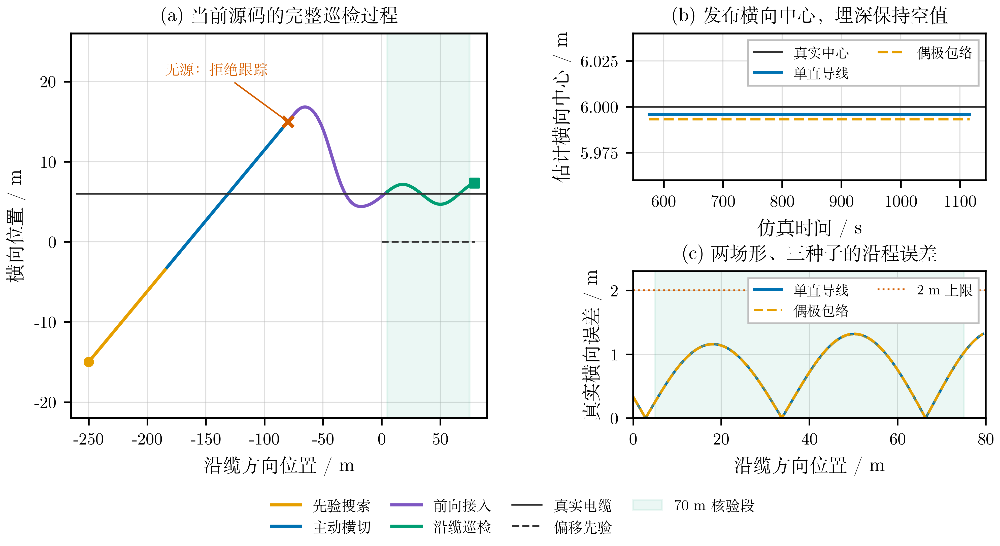
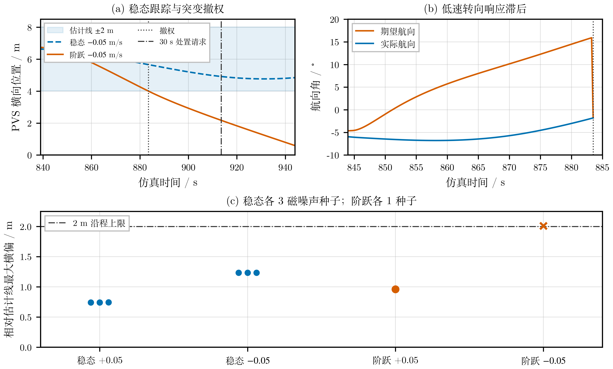
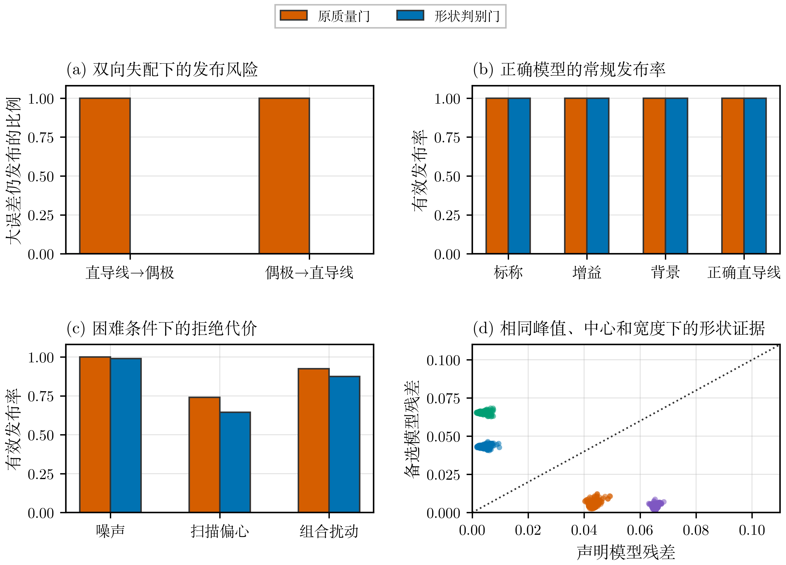
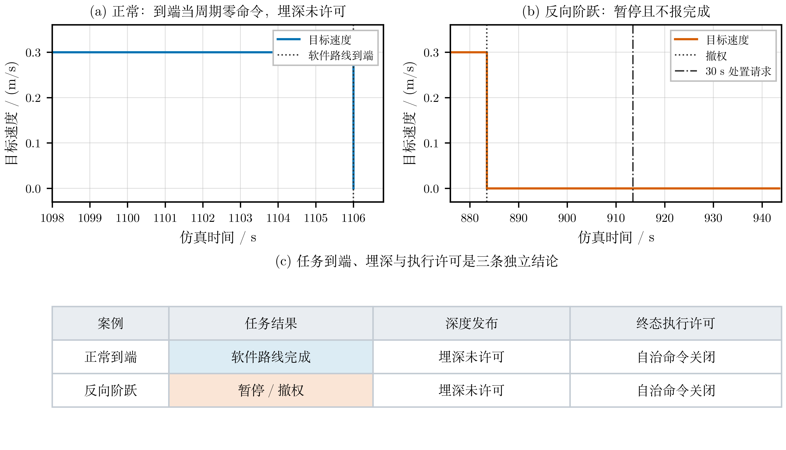

# 磁巡检 v2：限定条件下的仿真完成报告与答辩资产

**日期：2026-09-28。结论：按本次“磁算法在约束条件下完成可靠巡检，配齐可视化和答辩资产”的标准，仿真任务已经完成。** 完成范围是有限路线的横向巡检；埋深为独立可选输出。本报告和配套图像可随此文件夹独立发布，原有实验和 v1 均保留。

## 1. 完成的任务与明确约束

任务链为：先验引导搜索 → 磁检测 → 主动浅角横切 → 横向中心/显式 FWHM 质量检查 → 前向接入 → 有限路线巡检。FWHM 测宽、横向中心和埋深各自保留输出许可；不能可靠换算埋深时，系统仍可执行已确认目标的横向巡检。

本轮复验直接运行当前磁算法、原 PID、72 字节协议编解码和原生 PVS 动力学，不使用 HoloOcean，也不模拟 ROS 调度。真值只用于前向生成传感器输入及事后评价，不直接提供给磁估计器或跟踪目标。

| 条件 | 本次固定值或假设 |
| --- | --- |
| 目标与环境 | 已知孤立直线磁源，无邻线及其他磁干扰；真实源覆盖横切与任务段 |
| 地图误差 | 先验线 `y=0`，真实线 `y=6 m`；磁观测修正横向偏差 |
| 磁场 | 分别测试单直导线 `p=0.5` 与偶极包络 `p=1`；固定垂向尺度 3 m、标量背景 1 nT、幅值 20 nT、噪声标准差 0.03 nT |
| 导航和流 | 理想位置/航向输入，横流为 0；高度、姿态和车体磁干扰耦合不在本轮测试域内 |
| 扫描和接入 | 从 `(-250,-15)` 向 `(-80,15)` 浅角横切；既有 F 配方的 20 m 前向接入；先验侧向区间 `[2,8] m` |
| 任务范围 | 名义路线 `[0,80] m`，两端各留 5 m 缓冲；核验核心为 `[5,75] m`，长度 70 m |
| 运动与采样 | 名义速度 0.3 m/s；PVS 积分 0.05 s、算法步长 0.25 s；边界 `x∈[-270,120]、y∈[-30,30] m`，保留 10 m 余量 |
| 预设合格判据 | 核心段完整穿过、每周期连续正推进，真实横偏平均 ≤1 m、最大 ≤2 m；目标到端时协议主推为零；无源不得进入 Track |
| 埋深 | 未标定，始终空值；不把横向确认或高剖面置信度当作深度准确度 |

70 m 核心段是在种子 101 的初次观察后、102/103 复验前明确的任务范围。误差阈值沿用已有 F 配方，未因结果降低。噪声种子 101–103 只检验所列条件的重复性，不代表随机海况成功概率，也不保证任意高斯噪声实现或未知场形都能通过。

## 2. 当前版本的九条完整仿真



**图 71。** 左图展示搜索、主动横切、前向接入与沿缆巡检；地图横纵轴比例不同，便于观察横向修正。右上是磁估计中心与真实中心，右下计入核心路段内所有 Track 样本，包括回归修正。阴影为 70 m 核验段。埋深始终空值，任务到端不等于载体已经停止运动。同名 PDF 可用于论文/PPT。

| 当前版本条件 | 完成或拒绝 | 核心段真实横偏 MAE | 核心段最大真实横偏 |
| --- | --- | --- | --- |
| 单直导线，种子 101–103 | 3/3 完成且覆盖核心段 | 0.7736–0.7739 m | 1.3178–1.3188 m |
| 偶极包络，种子 101–103 | 3/3 完成且覆盖核心段 | 0.7710–0.7738 m | 1.3014–1.3206 m |
| 无磁源，种子 101–103 | 3/3 拒绝进入 Track | 不适用 | 不适用 |

六条正例均经历 Search、Confirm、Track，并在约 1116.25–1116.50 s 仿真时间到端；三条无源例在 578.5 s 搜索终点给出 `flythrough_no_detection`，未形成横向许可或误完成。九条运行均无异常退出，PVS 状态及记录的输入输出保持有限值；核心段全部周期为正协议主推，采样间隔为 0.25 s，到端或拒绝终态主推为零。该间隔是仿真步长，不是墙钟实时验收。

判据与逐趟指标见 [audit.json](audit.json)；原始 CSV、摘要、日志、运行源码、外部 PVS 源码和版本清单均在本包内。`tracking_mae_m` 是旧夹具按业务阶段生成的统计，本结论使用审阅器重新计算的 `core_mean_true_offset_m` 和 `core_max_true_offset_m`，不混用二者。

初始默认零接入配方的核心段平均误差约 1.064 m，超过 1 m 门。初稿审阅按“沿缆巡检”标签选样，漏掉回归修正，因此已明确作废；原始文件保存在另一个开发包，未覆盖。本包采用既有 20 m F 接入配方，计入全部核心段样本，并用针对漏样和中途 Hold 的三项回归防止假通过。本次没有改磁算法、PID、PVS 或生产固件。

## 3. 与既有 ROS 全链路和场形证据的对应



**图 61，独立历史版本。** 六条稳态正反 `0.05 m/s` 横流的 ROS/PID/守卫/UDP/PVS 正例均完成名义 80 m 任务；另一个正向阶跃例到端，反向阶跃例撤权。最大 0.742–1.234 m 横偏是相对冻结估计线的指标。八条原始轨迹本轮重新审阅为七条到端、一条撤权，见 [historical_route_recheck.json](historical_route_recheck.json)。这些结果与本轮零流原生 PVS 各自保留版本，不能拼接成当前 ROS 实时整链验收。



**图 13。** 声明场形的检查与深度发布分离，解决的是已测试模型对之间的错误发布；未知场形仍需要独立几何标定。本轮的横向巡检正例不依赖发布埋深，因此不会用同源深度的小误差掩盖模型失配问题。



**图 62，独立历史版本。** 可用于解释上位机为什么分别显示路线状态、深度许可和执行许可。与图 71 配合即可回答“完成了什么”和“哪些量仍应为空”。

## 4. 可直接插入 PPT 的内容

**方法页，建议图 71(a) 配图 13：**“通过主动浅角横切产生空间磁剖面，磁场首先约束横向测线；场形与独立标定通过后才允许由 FWHM 换算埋深。导航空间坐标、背景修正和双侧交点使过程可解释。”

**结果页，建议图 71：**“在孤立直线目标、6 m 先验偏差、理想导航和零横流的固定条件下，两种场形、各三个噪声种子均完成任务并覆盖 70 m 核心段。完整核心航迹平均横偏 0.771–0.774 m，最大 1.321 m；无源对照全部拒绝。结果计入回归修正，不以阶段标签筛去误差。”

**结论页，建议图 62：**“磁巡检 v2 已完成限定条件下的仿真闭环及展示资产。创新在于主动观测和分层许可：横向巡检与埋深发布分别成立，证据不足时保留可靠任务能力，并明确输出缺失量。”

口播可用：“我们把原来依赖单次深度估计的任务改为分层巡检工作流，先通过主动观测确认横向位置，再决定是否能够发布深度。仿真已经证明，在声明的条件下系统能够完成有限路线并正确拒绝无源场景。实物标定和部署时序是下一阶段验收。”

不要把 6/6 写成海况成功率，不把 0.25 s 仿真步长写成产品实时频率，也不把零命令或到端写成艇已停稳。既有时序诊断留在答问备份，不继续阻塞本次仿真完成标准。

## 5. 复跑与归档

在原仓库根目录，用新输出目录复跑，不覆盖本包：

```bash
mkdir -p /tmp/auv_v2_simulation_recheck
OPENBLAS_NUM_THREADS=1 OMP_NUM_THREADS=1 MKL_NUM_THREADS=1 PYTHONDONTWRITEBYTECODE=1 \
  /usr/bin/python3 tools/probe_v2_flythrough_simulation_candidate.py \
  --seed-start 101 --seeds 1 --output-dir /tmp/auv_v2_simulation_recheck/native_pvs \
  > /tmp/auv_v2_simulation_recheck/native_pvs.log 2>&1
OPENBLAS_NUM_THREADS=1 OMP_NUM_THREADS=1 MKL_NUM_THREADS=1 PYTHONDONTWRITEBYTECODE=1 \
  /usr/bin/python3 tools/probe_v2_flythrough_simulation_candidate.py \
  --seed-start 102 --seeds 2 --output-dir /tmp/auv_v2_simulation_recheck/native_seed102_103 \
  > /tmp/auv_v2_simulation_recheck/native_seed102_103.log 2>&1
PYTEST_DISABLE_PLUGIN_AUTOLOAD=1 /usr/bin/python3 -m pytest -q tests/test_v2_simulation_closure.py
```

主包依赖原仓库和相邻 `PythonVehicleSimulator-master`；运行时使用系统 Python 3.10.12、NumPy 1.24.4。`source_snapshot/` 与 `external_pvs_snapshot/` 用于核对来源，不是 ROS 安装或部署包。图片使用论文统一 FandolSong 宋体，提供 PNG/PDF；浏览本报告不需要安装字体。

另有当前磁算法 88/88、ROS 包 101/101 的已保存回归记录；本轮生产源码未修改，未重复整套测试。最终资产与完成判据见 [completion.json](completion.json)。完成标记仅适用于本次调整后的仿真目标；`field_release_authorized=false`。
